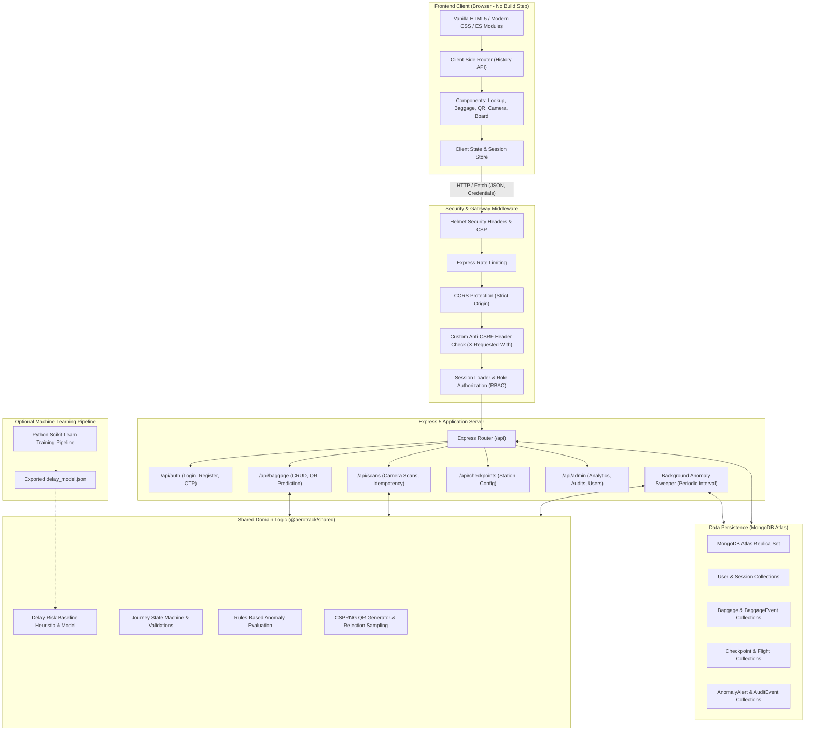

<div align="center">

# ✈️ AeroTrack Pro — Smart Airport Baggage Tracking and Monitoring System

### Modern Airport Baggage Tracking with CSPRNG-Generated QR Tags, Real-Time Checkpoint Auditing, Transparent Anomaly Alerts, and Explainable Delay-Risk Estimation

**Web Application Development (WAD) Academic Project · Master of Computer Applications (MCA)**  
**PSG College of Technology, Coimbatore**

[](https://nodejs.org/)
[](https://expressjs.com/)
[](https://www.mongodb.com/atlas)
[](https://developer.mozilla.org/en-US/docs/Web/JavaScript/Guide/Modules)
[](#testing--verification)
[](#academic-attribution--team)

</div>

---

## Table of Contents

1. [Project Overview](#project-overview)
2. [Academic Attribution & Team](#academic-attribution--team)
3. [Verified Features](#verified-features)
4. [Technology Stack & Architectural Rationale](#technology-stack--architectural-rationale)
5. [System Architecture Diagram](#system-architecture-diagram)
6. [Complete Project Folder Tree](#complete-project-folder-tree)
7. [Module-to-Code Mapping (Faculty Guide)](#module-to-code-mapping-faculty-guide)
8. [Quick Viva Examination Lookup](#quick-viva-examination-lookup)
9. [Prerequisites & System Requirements](#prerequisites--system-requirements)
10. [Local Installation & Setup](#local-installation--setup)
11. [Environment Configuration (.env)](#environment-configuration-env)
12. [Running the Application](#running-the-application)
13. [Testing & Verification](#testing--verification)
14. [MongoDB Atlas Setup & Security](#mongodb-atlas-setup--security)
15. [Deployment Guide (Render & Vercel)](#deployment-guide-render--vercel)
16. [Academic Limitations & Disclaimers](#academic-limitations--disclaimers)
17. [Troubleshooting Guide](#troubleshooting-guide)

---

## Project Overview

Airport passenger baggage mishandling, misplaced luggage during transit, and opaque baggage handling pipelines lead to passenger anxiety and significant operational friction.

**AeroTrack Pro** solves these challenges by providing a comprehensive, transparent, full-stack baggage tracking and monitoring ecosystem:
- **Passengers** can register luggage, view instantaneous journey status updates from check-in to reclaim carousel, display high-resolution QR tags, and review transparent delay-risk assessments.
- **Airport Ground Staff** can scan physical baggage QR tags, advance luggage through authorized status stages, search across airport flight rosters, and manage an interactive drag-and-drop operations board.
- **Airport Administrators** can configure physical checkpoint scanning stations, review automated anomaly alerts (unscreened skips, dwell bottlenecks, sequence violations), oversee user role permissions, audit security events, and inspect system KPIs.

The application strictly distinguishes **verified scan events** from demonstration records, estimates, and cached entries. It never falsely claims to track baggage coordinates between physical scans.

---

## Academic Attribution & Team

This project was developed collaboratively as part of the **Web Application Development (WAD)** curriculum for the **Master of Computer Applications (MCA)** degree program at **PSG College of Technology, Coimbatore**.

| Team Member | Academic Roll Number | Project Role | Core Contributions |
|---|---|---|---|
| **Sanjiv Kumar A** | **26MX217** | Developer | Original Repository Owner, Frontend UI Foundations, Core Express Routing & API Endpoints |
| **Dheena Dhayal M** | **26MX106** | Developer | CSPRNG Rejection Sampling QR Tag Engine, Verification Suites, System Audit, Comprehensive Documentation & Maintenance |
| **Rebakha Snowit M** | **26MX121** | Developer | Database Connection Scripts, Security Diagnostics, Checkpoint Seeders |

> **Repository Note:** The collaborative team repository is hosted at [https://github.com/SANJIVVV/AeroTrack](https://github.com/SANJIVVV/AeroTrack).

---

## Verified Features

1. **Cryptographically Secure RNG QR Tag Generation:**
   - Baggage references format: `AT-<YEAR>-<6 DIGITS>` (e.g. `AT-2026-849102`).
   - Employs **unbiased rejection sampling** over 32-bit unsigned cryptographic entropy (`globalThis.crypto.getRandomValues` / `crypto.randomBytes`) to mathematically eliminate modulo bias.
2. **Instant Baggage Lookup:**
   - Scan physical tags via HTML5 camera barcode scanner.
   - Lookup by typing baggage ID or pasting QR payloads (`AEROTRACK:BAG:AT-YYYY-DDDDDD`).
3. **Strict Checkpoint Journey Tracking:**
   - Linear 8-stage main flow: `REGISTERED` -> `CHECKED_IN` -> `SECURITY_SCREENING` -> `LOADED` -> `IN_TRANSIT` -> `ARRIVED` -> `ON_BELT` -> `COLLECTED`.
   - Idempotency key tracking on scan submissions prevents accidental duplicate barcode reads.
4. **Interactive Operations Board:**
   - Ground staff can advance baggage through workflow stages with touch, mouse, or keyboard controls.
   - Optimistic concurrency control using document versioning (`If-Match` / `version` field) prevents lost updates.
5. **Rules-Based Anomaly Detection:**
   - Flags suspicious baggage events: duplicate rapid scans, unauthorized backward transitions, skipped security checkpoints, and airport-to-flight mismatches.
6. **Explainable Delay-Risk Estimation:**
   - Evaluates a 9-feature operational vector to calculate delay probability.
   - Provides transparent factor breakdowns in the user interface (e.g. dwell time, skipped checkpoints).
7. **Role-Based Authentication & Access Control:**
   - Secure cookie sessions with `HttpOnly` and `SameSite` flags.
   - 6-digit OTP challenges for account verification and password resets with cooldown timers.
   - Granular RBAC permissions for `passenger`, `staff`, and `admin` roles.
8. **Comprehensive Admin Governance:**
   - System analytics, station checkpoint toggling, flight schedule entries, audit event trail, and user account management.

---

## Technology Stack & Architectural Rationale

| Layer | Technology | Version | Architectural Rationale |
|---|---|---|---|
| **Frontend** | Vanilla HTML5, CSS3, ES Modules | Standard | Zero build overhead, native browser performance, instant live updates, fast cold load times without complex bundler dependencies. |
| **Backend** | Node.js + Express 5 | 20.19+ / 5.1.0 | Fast asynchronous event-driven I/O, native ESM support, robust middleware ecosystem, and modern routing capabilities. |
| **Database** | MongoDB Atlas with Mongoose | 8.24+ | Schema-flexible document database ideally suited for nested events, audit logs, flight manifests, and indexing unique references. |
| **Shared Logic** | Vanilla JavaScript Workspace (`@aerotrack/shared`) | Custom | Shared source of truth across client and server for state transition graphs, anomaly rules, QR parsers, and risk metrics. |
| **Security** | Helmet, Bcryptjs, Rate-Limiting | Latest | Robust defenses against XSS, clickjacking, brute-force attacks, and query parameter injection. |
| **Testing** | Node.js Native Test Runner (`node:test`) | Built-in | Fast, lightweight, zero external overhead test runner with built-in assertion module. |
| **ML Pipeline** | Python (Scikit-Learn, Pandas, NumPy) | 3.10+ | Explainable logistic regression training pipeline that exports portable JSON weights for real-time Node.js scoring. |

---

## System Architecture Diagram



---

## Complete Project Folder Tree

```text
AeroTrack-main/
├── .env.example                     # Environment template with security instructions
├── .gitignore                       # Ignored build, log, environment, and cache files
├── .prettierrc.json                 # Code formatting specifications
├── eslint.config.js                 # ESLint flat configuration for frontend and backend
├── package.json                     # Root project workspaces, dependencies, and scripts
├── package-lock.json                # Deterministic dependency tree lock
├── render.yaml                      # Render Blueprint web service configuration
├── vercel.json                      # Vercel serverless and static routing configuration
├── README.md                        # Master project documentation
├── QR_RNG_INTEGRATION.md            # CSPRNG mathematical specification and integration report
├── api/
│   └── index.js                     # Vercel Serverless Function entry point adapter
├── backend/                         # Node.js + Express 5 Server Workspace
│   ├── package.json                 # Backend dependencies and execution scripts
│   ├── server.js                    # Convenience server entry point (imports src/index.js)
│   ├── seed.js                      # Convenience seed runner (imports src/scripts/seedDirectory.js)
│   ├── src/
│   │   ├── index.js                 # HTTP server entry point and background sweeper
│   │   ├── app.js                   # Express application setup, CSP, CORS, routes
│   │   ├── bootstrap.js             # Service container, MongoDB connection, email config
│   │   ├── context.js               # Application context interface definition
│   │   ├── config/
│   │   │   ├── db.js                # Mongoose connection manager and ping diagnostics
│   │   │   └── env.js               # Zod-validated environment schema and URI redaction
│   │   ├── controllers/             # Express MVC Request/Response Controllers
│   │   ├── middleware/              # Express Middleware Pipeline
│   │   ├── models/                  # Mongoose Schemas & Data Models
│   │   ├── routes/                  # Express Modular Route Definitions
│   │   ├── services/                # Reusable Business Logic Services
│   │   ├── scripts/                 # Administrative CLI Tooling
│   │   ├── utils/                   # Shared Server Utilities & Logging
│   │   └── validators/
│   │       └── common.js            # Shared Zod validation schemas
│   └── test/                        # Backend Test Suite
├── docs/                            # In-Depth Project Documentation & Guides
│   ├── API_DOCUMENTATION.md         # Full REST API endpoint specification
│   ├── PROJECT_ARCHITECTURE.md      # In-depth architectural analysis
│   ├── PROJECT_MODULE_AND_CODE_GUIDE.md # Academic study handbook
│   └── PROJECT_MODULE_AND_CODE_GUIDE.pdf # Formatted PDF handbook for viva
├── frontend/                        # Plain HTML/CSS/JS Single-Page Application
│   ├── index.html                   # HTML5 single-page application shell
│   ├── manifest.webmanifest         # PWA progressive web app manifest
│   ├── sw.js                        # Service worker for offline asset caching
│   ├── css/
│   │   └── styles.css               # Clean responsive styling, light/dark themes
│   ├── icons/                       # Brand and application iconography
│   ├── libraries/                   # Vendor libraries (html5-qrcode, qrcode.js)
│   └── js/
│       ├── config.js                # Client runtime API base configuration
│       ├── main.js                  # Frontend entry point, route table, and layouts
│       ├── theme-init.js            # Pre-render light/dark theme initializer
│       ├── components/              # Modular UI components (baggage, lookup, otp)
│       ├── lib/                     # Client utilities (api, auth, dom, router, toast)
│       └── pages/                   # SPA page renderers (landing, passenger, staff, admin)
├── ml-model/                        # Explainable Delay-Risk ML Pipeline
│   ├── README.md                    # ML architecture and training guide
│   ├── requirements.txt             # Python dependencies (scikit-learn, pandas, numpy)
│   ├── train.py                     # Logistic regression training script
│   └── models/                      # Directory for exported delay_model.json
└── shared-utils/                    # Domain Logic Shared Across Client & Server
    ├── package.json                 # Workspace package definition
    ├── src/                         # Shared domain rules, QR, status, anomaly, prediction
    └── test/                        # Shared Utils Test Suite
```

---

## Module-to-Code Mapping (Faculty Guide)

Use this table to immediately identify which files power any feature when demonstrating to faculty:

| Module | Frontend View / Component | Backend Route & Controller | Database Model | Key Functions |
|---|---|---|---|---|
| **Authentication & RBAC** | `frontend/js/pages/auth.js`<br>`frontend/js/components/otp.js` | `backend/src/routes/auth.js`<br>`backend/src/middleware/auth.js` | `User.js`<br>`Session.js`<br>`OtpChallenge.js` | `register`, `verifyOtp`, `login`, `logout`, `requireRole`, `issueOtp` |
| **Baggage Registration** | `frontend/js/pages/passenger.js`<br>`frontend/js/components/baggage.js` | `backend/src/routes/baggage.js` | `Baggage.js`<br>`Flight.js` | `generateReference`, `Baggage.create`, `toBaggageDTO` |
| **QR Code Generation** | `frontend/js/components/baggage.js`<br>`frontend/libraries/qrcode.js` | `backend/src/routes/baggage.js` | `Baggage.js` | `generateReference`, `toQrPayload`, `QRCode.toString` |
| **Baggage Tracking & Lookup** | `frontend/js/pages/passenger.js`<br>`frontend/js/components/lookup.js` | `backend/src/routes/baggage.js` | `Baggage.js`<br>`BaggageEvent.js` | `loadAccessibleBag`, `normalizeReference`, `parseLookupInput` |
| **Checkpoint Scanning** | `frontend/js/pages/staff.js`<br>`frontend/libraries/html5-qrcode.min.js` | `backend/src/routes/scans.js`<br>`backend/src/services/tracking.js` | `Checkpoint.js`<br>`BaggageEvent.js` | `processScan`, `changeStatus`, `checkTransition` |
| **Operations Board** | `frontend/js/pages/board.js` | `backend/src/routes/baggage.js` | `Baggage.js` | `changeStatus`, `allowedNextStatuses` |
| **Anomaly Detection** | `frontend/js/pages/staff.js` (`alertsPage`) | `backend/src/routes/alerts.js`<br>`backend/src/services/alerts.js` | `AnomalyAlert.js` | `evaluateScan`, `evaluateDwell`, `runAnomalySweep` |
| **Delay-Risk Estimation** | `frontend/js/components/baggage.js` | `backend/src/services/prediction.js`<br>`shared-utils/src/prediction.js` | `PredictionRecord.js` | `estimateDelay`, `buildFeatures`, `baselineRisk`, `logisticRisk` |
| **Station Checkpoints** | `frontend/js/pages/admin.js` (`systemPage`) | `backend/src/routes/checkpoints.js` | `Checkpoint.js` | `seedCheckpoints`, `Checkpoint` CRUD |
| **User Administration** | `frontend/js/pages/admin.js` (`usersPage`) | `backend/src/routes/admin.js` | `User.js`<br>`Session.js` | `User` management, `Session.deleteMany` |
| **Incident Reporting** | `frontend/js/pages/general.js` | `backend/src/routes/incidents.js` | `Incident.js` | `Incident` creation, listing, `notify` |
| **System Audit Trail** | `frontend/js/pages/admin.js` (`auditPage`) | `backend/src/routes/admin.js`<br>`backend/src/services/audit.js` | `AuditEvent.js` | `audit`, audit log listing |

---

## Quick Viva Examination Lookup

| Faculty Question | File to Open | Exact Explanation to Give |
|---|---|---|
| **"Where is user authentication implemented?"** | `backend/src/routes/auth.js`<br>`backend/src/middleware/auth.js` | Registration hashes passwords with `bcryptjs` (salt rounds 12). Login creates an authenticated `Session` in MongoDB and sets an `HttpOnly`, `SameSite` session cookie. Roles are enforced via `requireRole('staff', 'admin')`. |
| **"Where is the database connected?"** | `backend/src/config/db.js` | Mongoose connects via `connectDatabase(uri, dbName)`. It enables strict query filters to prevent NoSQL injection, checks `readyState` to avoid reconnection thrashing, and redacts passwords from all log outputs. |
| **"How does the QR generation algorithm work?"** | `shared-utils/src/qr.js` | Generates `AT-<YEAR>-<6 DIGITS>` references from cryptographic random bytes (`node:crypto` `randomBytes`), formatted into `AEROTRACK:BAG:<REF>` payloads. |
| **"Where is baggage registered and stored?"** | `backend/src/routes/baggage.js` | Handled by `POST /api/baggage`. Checks flight eligibility, verifies user limits (max 10 bags), invokes `generateReference` with retry logic for uniqueness, stores the `Baggage` document, creates the initial `BaggageEvent`, and logs an audit event. |
| **"Where are state machine transitions enforced?"** | `shared-utils/src/status.js`<br>`backend/src/services/tracking.js` | `checkTransition(current, next, lastMain)` evaluates candidate moves. Forward skips report skipped intermediate stages, backward transitions return `{ ok: false, reason: 'BACKWARD' }`, and terminal states prevent further moves. |
| **"How does anomaly detection operate?"** | `shared-utils/src/anomaly.js`<br>`backend/src/services/alerts.js`<br>`backend/src/services/tracking.js` | `evaluateScan()` checks for duplicate scans within 120 seconds, invalid sequence regressions, missing security checkpoints, and airport-to-flight mismatches, raising persistent `AnomalyAlert` documents with evidence. |
| **"How does delay-risk prediction calculate scores?"** | `shared-utils/src/prediction.js`<br>`backend/src/services/prediction.js` | `buildFeatures()` creates a 9-feature operational vector (dwell ratio, skipped scans, departure proximity). `baselineRisk()` computes a bounded, transparent weighted score. If `delay_model.json` is loaded, `logisticRisk()` computes logistic log-odds. |
| **"How are NoSQL injection attacks prevented?"** | `backend/src/validators/common.js` | Every request parameter, query, and payload is validated against strict **Zod schemas** before reaching any MongoDB query. Unexpected query operators (such as `$gt` or `$ne`) are stripped and rejected at the gateway. |
| **"How is CSRF prevented with cookie sessions?"** | `backend/src/middleware/security.js` | `requireCsrfHeader` rejects any state-changing HTTP request (`POST`, `PATCH`, `DELETE`) unless it carries the custom header `X-Requested-With: aerotrack`. Browsers cannot attach this header cross-origin without an explicit CORS preflight. |
| **"Why is the client served without a build step?"** | `backend/src/app.js`<br>`frontend/js/main.js` | The client is built with modern ES Modules natively supported by all modern browsers. Express serves the static assets with `Cache-Control: no-cache` on code files, simplifying maintenance and development for students. |

---

## Prerequisites & System Requirements

- **Node.js:** `v20.19.0` or higher (Node 20+ required for native test runner and crypto features).
- **npm:** `v10.0.0` or higher.
- **Database:** MongoDB Atlas account or locally accessible MongoDB server (v6.0+).
- **Git:** Standard Git installation.
- **Python (Optional):** Python 3.10+ (only required if training custom ML models).

---

## Local Installation & Setup

1. **Clone the repository:**
   ```bash
   git clone https://github.com/SANJIVVV/AeroTrack.git
   cd AeroTrack
   ```

2. **Install project dependencies:**
   ```bash
   npm install
   ```

3. **Configure environment settings:**
   ```powershell
   Copy-Item .env.example .env
   ```
   *(On macOS / Linux: `cp .env.example .env`)*

4. **Edit `.env` and supply your database connection and secrets:**
   - Set `MONGODB_URI` to your MongoDB Atlas connection string.
   - Generate a strong session secret and set `SESSION_SECRET`:
     ```bash
     node -e "console.log(require('crypto').randomBytes(48).toString('base64url'))"
     ```

5. **Verify database connectivity:**
   ```bash
   npm run db:check
   ```

6. **Seed baseline demonstration directory:**
   ```bash
   npm run seed
   ```

---

## Environment Configuration (.env)

| Variable | Required | Default | Description |
|---|---|---|---|
| `NODE_ENV` | No | `development` | Environment mode (`development`, `test`, `production`). |
| `PORT` | No | `4000` | Port for the HTTP server to listen on. |
| `MONGODB_URI` | **Yes** | None | Full MongoDB Atlas connection URI (`mongodb+srv://...`). |
| `MONGODB_DB_NAME` | No | `aerotrack_pro` | MongoDB database name. |
| `SESSION_SECRET` | **Yes** | None | Minimum 32-character random string for cryptographic cookie signing. |
| `SESSION_TTL_HOURS` | No | `168` | Session duration in hours (default: 7 days). |
| `CLIENT_URL` | No | `http://localhost:4000` | Public URL of the frontend application (used for CORS). |
| `CORS_ORIGINS` | No | None | Comma-separated list of additional allowed origin URLs. |
| `EMAIL_PROVIDER` | No | `dev` | `dev` (displays OTP in UI), `smtp` (sends real email), or `none`. |
| `SMTP_HOST` | Conditional | None | SMTP mail server hostname (required when `EMAIL_PROVIDER=smtp`). |
| `SMTP_PORT` | No | `587` | SMTP port. |
| `SMTP_USER` | Conditional | None | SMTP username. |
| `SMTP_PASS` | Conditional | None | SMTP application password. |
| `EMAIL_FROM` | Conditional | None | From email address header. |
| `TRUST_PROXY` | No | `false` | Set to `true` when running behind Render, Vercel, or Nginx. |
| `SERVE_CLIENT` | No | `true` | Serve the `frontend/` single-page application from Express. |
| `DELAY_MODEL_PATH` | No | None | Relative path to exported ML JSON model (falls back to rules baseline). |
| `ANOMALY_SWEEP_INTERVAL_MIN` | No | `5` | Minutes between automatic dwell-time anomaly scans (`0` disables). |
| `LOG_LEVEL` | No | `info` | Pino logging level (`fatal`, `error`, `warn`, `info`, `debug`). |

---

## Running the Application

### Development Mode (Auto-Reloading)
```bash
npm run dev
```
Open **[http://localhost:4000](http://localhost:4000)** in your browser.

### Production Mode
```bash
npm start
```

### Seeding Checkpoints & Roles
```bash
# Seed initial scanning stations for Chennai (MAA) and Delhi (DEL)
npm run seed:checkpoints -w backend -- MAA DEL

# Promote an account to administrator
npm run set-role -w backend -- your-email@example.com admin
```

---

## Testing & Verification

AeroTrack Pro includes an automated test suite powered by the Node.js native test runner:

```bash
# Run all test suites (Shared utils and Backend API)
node --test shared-utils/test/*.test.js backend/test/*.test.js

# Run ESLint code style and syntax checks
npm run lint
```

### Test Coverage Summary:
- **`shared-utils/test/qr.test.js`**: Rejection sampling distribution, format conformity (`AT-YYYY-DDDDDD`), and QR payload formatting.
- **`shared-utils/test/status.test.js`**: Journey progression, forward skips, backward rejections, and exception resumes.
- **`shared-utils/test/anomaly.test.js`**: Duplicate barcode scans, invalid transitions, skipped security checks, and airport mismatches.
- **`shared-utils/test/prediction.test.js`**: 9-feature extraction, rules baseline risk bounds, and logistic regression scoring.
- **`backend/test/env.test.js`**: Zod environment validation, URL redaction, and CORS parsing.
- **`backend/test/security.test.js`**: Bcrypt hashing, constant-time compare, and CSRF header verification.
- **`backend/test/api.test.js`**: `/api/health` system readiness and 404 handler diagnostics.

---

## MongoDB Atlas Setup & Security

1. **Create an Atlas Cluster:** Create a free M0 cluster on [MongoDB Atlas](https://www.mongodb.com/atlas).
2. **Database User:** Create a dedicated database user (e.g. `aerotrack_app`) with read/write permissions strictly scoped to `aerotrack_pro`.
3. **URL-Encoding:** If your password contains special characters (`@`, `:`, `/`, `?`, `#`), percent-encode them before placing in `MONGODB_URI`.
4. **Network Access (IP Whitelist):**
   - For local development: Add your current public IP address or `0.0.0.0/0` (with strong password).
   - For deployment: Allow access from deployment host IPs or `0.0.0.0/0`.
5. **Connection String Test:** Run `npm run db:check` to execute a non-destructive ping, write, read, and delete cycle.

---

## Deployment Guide (Render & Vercel)

AeroTrack Pro supports two primary deployment architectures:

### Option 1: Render (Recommended & Full-Featured)
The repository includes a ready-to-use [`render.yaml`](render.yaml) configuration:
1. Connect your GitHub repository to [Render](https://render.com).
2. Create a new **Web Service** from Blueprint (`render.yaml`).
3. Set environment variables in the Render dashboard:
   - `MONGODB_URI`
   - `SESSION_SECRET`
   - `CLIENT_URL` (e.g. `https://aerotrack-pro.onrender.com`)
4. **Why Render is optimal:** Background timers (`setInterval` anomaly sweeps) and persistent memory stores continue running without interruption.

### Option 2: Vercel (Static Frontend + Serverless API)
The repository includes [`vercel.json`](vercel.json) and [`api/index.js`](api/index.js):
1. Connect your repository to [Vercel](https://vercel.com).
2. Set Environment Variables (`MONGODB_URI`, `SESSION_SECRET`, `TRUST_PROXY=true`).
3. Vercel automatically deploys:
   - `frontend/` as high-performance global Edge Static assets.
   - `api/index.js` as an Express serverless function for `/api/*`.
4. *Note on Serverless:* Periodic background interval timers freeze between invocations in serverless environments; trigger scans on demand or via external Cron.

---

## Academic Limitations & Disclaimers

1. **No External Hardware or RFID Integration:** Baggage tracking relies exclusively on optical 2D QR camera barcode scans and manual inputs. Physical RFID interrogators are not connected.
2. **Demonstration Flight Schedules:** Airlines and flight schedules are generated demo rosters; the project does not integrate with live ADS-B flight-tracking APIs or commercial airline reservation systems.
3. **Discrete Checkpoint Scans:** The system tracks baggage strictly at discrete scan points; it does not claim to know continuous GPS coordinates while luggage is in transit between stations.
4. **Explainable Risk Estimates:** Delay probabilities are predictive operational estimates designed to aid ground staff and manage expectations, not deterministic guarantees.

---

## Troubleshooting Guide

| Issue | Cause | Proven Solution |
|---|---|---|
| `Invalid environment configuration: MONGODB_URI is required` | `.env` file is missing or `MONGODB_URI` is blank. | Copy `.env.example` to `.env` and fill in your MongoDB Atlas connection string. |
| `Could not connect to MongoDB at ... serverSelectionTimeoutMS` | IP address is not whitelisted in MongoDB Atlas Network Access. | Log in to MongoDB Atlas -> **Network Access** -> Click **Add IP Address** -> Add your current IP or `0.0.0.0/0`. |
| `TypeError: req.get is not a function` | Custom HTTP client sent request without Express header wrappers. | Use standard browser `fetch` or the included frontend API library (`frontend/js/lib/api.js`). |
| `403 CSRF: Missing request header` | State-changing request (`POST`, `PATCH`, `DELETE`) omitted the CSRF header. | Ensure the request includes the header `X-Requested-With: aerotrack`. |
| Camera QR Scanner will not open | Browser requires HTTPS or `localhost` for camera media device permissions. | Access the app via `http://localhost:4000` or configure an SSL certificate (HTTPS) on your deployed domain. |

---

<div align="center">

**AeroTrack Pro — Academic Demonstration Project**  
Department of Computer Applications · PSG College of Technology, Coimbatore

</div>
