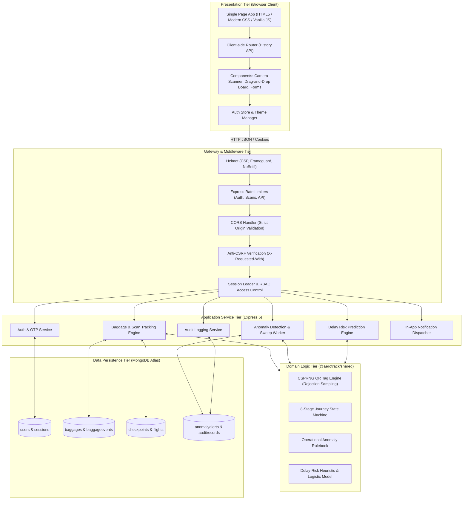
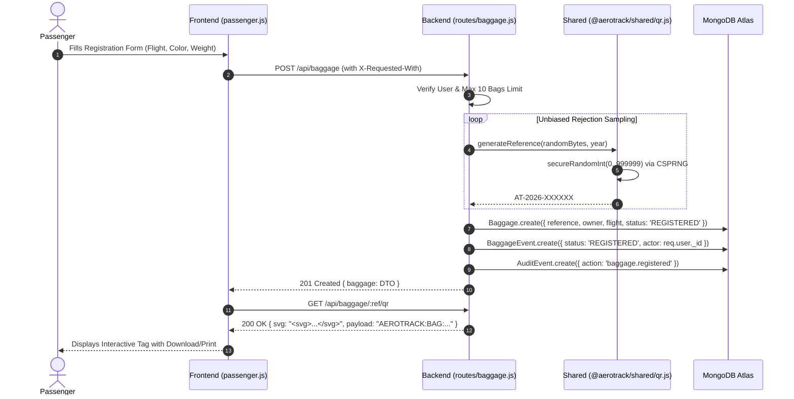
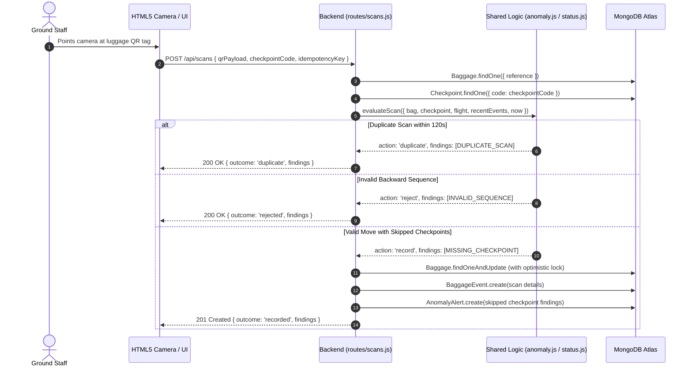

# AeroTrack Pro — Comprehensive Project Architecture

This document details the architectural design, system components, communication patterns, security mechanisms, and deployment strategies of **AeroTrack Pro: Smart Airport Baggage Tracking and Monitoring System**.

---

## 1. System Overview & Design Philosophy

AeroTrack Pro is architected as an **auditable, event-driven, full-stack web application** designed specifically for airport luggage tracking.

### Core Architectural Principles:
1. **Explainability Over Black-Box Automation:**  
   Every state transition, anomaly alert, and delay prediction provides explicit evidence, reasons, and factor breakdowns. The system never asserts claims it cannot verify.
2. **Discrete Physical Verification:**  
   Baggage location is determined strictly by verified checkpoint barcode scans. The system never claims continuous GPS tracking between physical scanning stations.
3. **Decoupled Domain Logic:**  
   Core business rules—state machines, anomaly rules, reference generation, and prediction algorithms—are isolated in `@aerotrack/shared` and reused seamlessly by both frontend and backend.
4. **Zero-Build Native Frontend:**  
   The client leverages native ES Modules and modern web standards. This eliminates build tool fragility, speeds up local development, and allows faculty to inspect client code in the browser DevTools directly.
5. **Defense-in-Depth Security:**  
   Security is enforced at multiple layers: Helmet security headers, Content Security Policy (CSP), custom anti-CSRF headers, bcrypt password hashing, and strict Zod schema validation on all inputs.

---

## 2. Multi-Tier Architecture



---

## 3. End-to-End Request-Response Flow

Every client request follows an explicit lifecycle that ensures validation, authorization, and error containment before touching the database:

```
[User Action in Browser UI]
            │
            ▼
[DOM Event Listener (Submit/Click/Scan)]
            │
            ▼
[Frontend API Helper (`frontend/js/lib/api.js`)]
  - Attaches `X-Requested-With: aerotrack`
  - Sets `credentials: 'include'`
            │
            ▼
[Express 5 Server (`backend/src/app.js`)]
            │
            ├──> [Helmet CSP & Security Headers]
            ├──> [CORS Validation (`corsOrigins`)]
            ├──> [Rate Limiter (`createLimiters`)]
            ├──> [CSRF Validation (`requireCsrfHeader`)]
            └──> [Session Loader (`loadSession`)]
                        │
                        ▼
            [Role-Based Guard (`requireRole('staff', 'admin')`)]
                        │
                        ▼
            [Zod Schema Validator (`parse(schema, req.body)`)]
                        │
                        ▼
            [Route Controller & Service Layer (`services/tracking.js`)]
                        │
                        ├──> [Evaluate Transition / Anomaly Rules]
                        ├──> [MongoDB Atlas Operation via Mongoose]
                        ├──> [Create BaggageEvent & Audit Log]
                        └──> [Evaluate Delay Risk Snapshot]
                        │
                        ▼
            [DTO Serializer (`toBaggageDTO`)]
                        │
                        ▼
            [HTTP 200/201 JSON Response to Browser]
                        │
                        ▼
            [Frontend DOM Update & Toast Notification]
```

---

## 4. Key Sequence Diagrams

### 4.1. Baggage Registration & QR Allocation



### 4.2. Checkpoint Scanning & Anomaly Interception



---

## 5. Deployment Architecture Analysis: Vercel vs Render

### Architectural Comparison Matrix

| Evaluation Criterion | Render Web Service (Current / Native) | Vercel Serverless Function |
|---|---|---|
| **Architecture Type** | Long-running Node.js Container Process | Ephemeral On-Demand Serverless Lambdas |
| **Frontend Delivery** | Served directly by Express (`express.static`) | Global Edge Content Delivery Network (CDN) |
| **Background Sweeps** | Supported natively via `setInterval` sweeper | **Unsupported natively**; requires external cron trigger |
| **Database Connections** | Persistent Mongoose connection pool | Reconnects on cold starts; pool exhaustion risk |
| **In-Memory Outbox (Dev)** | Persists in memory across requests | Reset on every lambda cold start |
| **Rate Limiter Storage** | In-memory token buckets work across sessions | Not shared across concurrent lambda instances |
| **WebSocket / Push** | Supported for future real-time feeds | Requires third-party service (e.g. Pusher) |
| **Cold Start Latency** | None (always running) | 500ms – 2500ms on initial spin-up |

### Recommended Deployment Strategy

1. **All-in-One Dedicated Hosting (Render / Railway / VPS):**  
   Best for preserving 100% of the project's native features including background anomaly sweeps, in-memory OTP diagnostics, and steady Mongoose connection pools.
2. **Decoupled Edge + API (Vercel Frontend + Render API):**  
   Deploy `frontend/` to Vercel for ultra-fast CDN delivery worldwide, and deploy `backend/` to Render. Configure `window.AEROTRACK_API_BASE` in `frontend/js/config.js` to point to the Render API URL.
3. **All-in-One Vercel:**  
   Supported via the included `vercel.json` and `api/index.js` adapter. Note that background sweeper intervals do not run continuously on serverless and must be triggered on demand.
